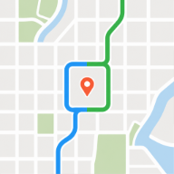

<div align="center">
  <h1>
    
    <br>
    Drivers Against Flock
  </h1>

**Know where the cameras are. Choose how you get there.**

A privacy-focused mapping and navigation app that helps drivers find known automated license plate readers (ALPRs) and compare routes around them, using public OpenStreetMap data.

[Explore the map](https://driversagainstflock.org/map) · [iPhone](https://apps.apple.com/us/app/drivers-against-flock/id6741054638) · [Android](https://play.google.com/store/apps/details?id=com.anonymous.drivefree)

</div>

---

[Features](#features) · [Contributing](#contributing) · [License](#data-and-license)

## Why this project exists

Roadside license plate readers can turn ordinary journeys into a record of where people travel. Drivers Against Flock makes known camera locations visible and gives drivers more information when choosing a route.

The map and routing are free to use, with no account required. Camera locations come from OpenStreetMap contributors, so the map improves as people add and correct public data.

## Features

| Feature                   | What it does                                                                               |
| ------------------------- | ------------------------------------------------------------------------------------------ |
| **Camera map**            | Explore known ALPRs and roadside surveillance cameras, with location and device details.   |
| **Route comparison**      | Search for a destination and compare routes with camera avoidance in mind.                 |
| **Driving navigation**    | Follow directions and receive camera alerts on your phone, Android Auto, or Apple CarPlay. |
| **Scorecard**             | Review locally recorded trips and camera exposure events on your phone.                    |
| **OpenStreetMap editing** | Add or correct camera data from the app using an OpenStreetMap account.                    |
| **Area alerts**           | Subscribe to camera changes in areas you care about.                                       |
| **Moderation tools**      | Review nodes, changesets, editor activity, and flagged changes through the web interface.  |

Camera coverage depends on community data. Routes and alerts may miss cameras or use outdated information; they do not guarantee a camera-free journey.

## Contributing

Bug reports, reproducible examples, and focused suggestions help improve the project. Use [GitHub issues](https://github.com/layered-tech/driversagainstflock/issues) to describe a problem or discuss a larger change before implementation. For camera data corrections, use the app's OpenStreetMap editing flow or edit the underlying OpenStreetMap data.

You may fork, modify, and locally test the code to submit a PR to this repository under the [contribution permission](LICENSE.md#contribution-permission).

### Pull requests

Keep each PR focused on one change and follow the existing code style. Use a short Conventional Commit title, such as:

```text
fix(map): preserve navigation after car disconnects
feat(moderation): filter nodes by review status
docs: clarify the project overview
```

The [PR template](.github/pull_request_template.md) will prompt you to include:

- **Problem and change:** What prompted the PR and how behavior changes. Link a related issue when applicable.
- **Validation:** What you tested, the results, and anything still unverified.
- **Screenshots or recordings:** Before/after evidence for visible changes.
- **Rollout notes:** Any migrations, configuration changes, or rebuild requirements.

Add or update tests for behavior changes. Keep the description proportional to the change; a small fix only needs a few sentences and its test results.

## Data and license

Camera data comes from OpenStreetMap contributors and has its own attribution and licensing requirements. Preserve that attribution when changing maps, data displays, or exports.

The application source is **all rights reserved**, copyright © 2026 Layered Tech LLC, with permission to fork, modify, and locally test it for PRs to this repository. Other uses, distribution, and deployment require written permission. See [`LICENSE.md`](LICENSE.md) for the full terms.
